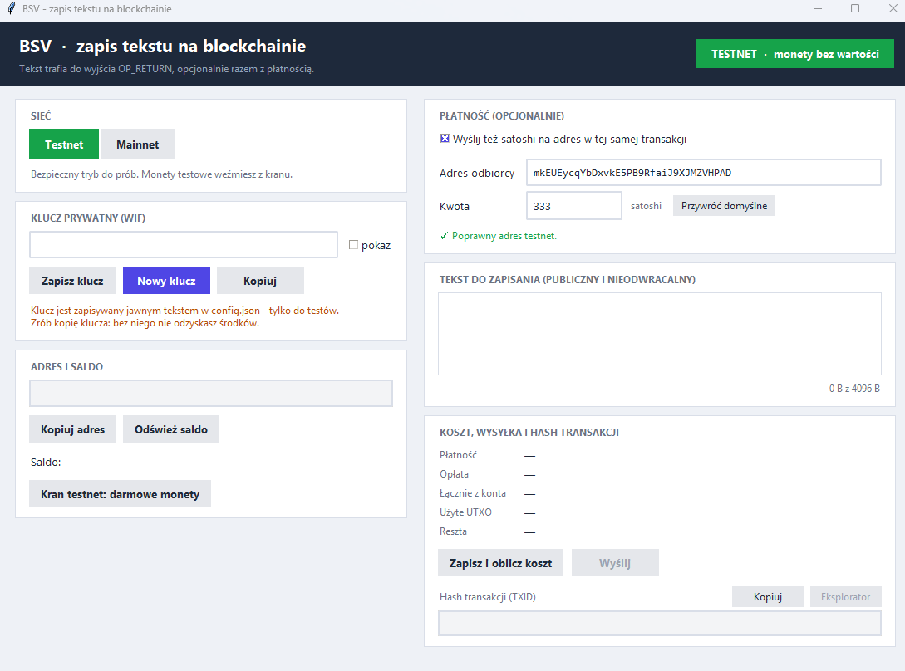

# BSV Text Writer

Prosta aplikacja z oknem (Python + tkinter), która zapisuje **krótki tekst na blockchainie Bitcoin SV**
(w wyjściu `OP_RETURN`) i opcjonalnie wysyła w tej samej transakcji kilka satoshi na wybrany adres.
Działa na **testnecie** i **mainnecie**, a sieć przełączasz jednym kliknięciem.

> **Projekt do nauki i testów.** Klucz prywatny jest zapisywany w pliku jawnym tekstem. Używaj go
> na testnecie albo z kluczem, na którym nie ma ważnych środków. Szczegóły w sekcji [Bezpieczeństwo](#bezpieczeństwo).



## Co potrafi

- **Przełącznik sieci** testnet / mainnet. Kolorowy znacznik w nagłówku pokazuje, na której sieci pracujesz.
- **Klucz prywatny (WIF)**: wklejasz własny albo generujesz nowy jednym przyciskiem, a przycisk „Zapisz klucz” zapisuje go do `config.json`.
- **Adres** wyliczany z klucza. Format zmienia się razem z siecią (testnet `m…` / `n…`, mainnet `1…`).
- **Saldo** z rozbiciem: saldo potwierdzone, środki do wydania i UTXO, które program celowo pomija (wyjaśnia, czemu liczby się różnią).
- **Kran testnetu**: przycisk otwierający <https://faucet.bananablocks.com/> oraz „Kopiuj adres”.
- **Płatność (opcjonalnie)**: domyślnie 333 satoshi na mój [testowy] adres `mkEUEycqYbDxvkE5PB9RfaiJ9XJMZVHPAD`, ale adres i kwotę możesz zmienić albo wyłączyć płatność. Adres jest sprawdzany pod kątem wybranej sieci.
- **Tekst do zapisania**: pole na kilka zdań (UTF-8, polskie znaki działają) z licznikiem bajtów.
- **Obliczenie kosztu** przed wysłaniem: opłata, łączny wydatek, użyte UTXO i reszta.
- **Wysyłka** i wyświetlenie **TXID** z przyciskami „Kopiuj” i „Eksplorator”.

## Wymagania

- Python 3.11 lub nowszy (z tkinterem; w Windows jest w standardowej instalacji)
- Pakiety z `requirements.txt` (`bsv-sdk`, `requests`, `aiohttp`, `pycryptodomex`)
- Dostęp do internetu (dane i rozgłaszanie przez [WhatsOnChain](https://whatsonchain.com))

## Instalacja i uruchomienie

```bash
git clone https://github.com/xpanalyst/bsv-text-writer.git
cd bsv-text-writer

python -m venv .venv
# Windows (PowerShell):  .venv\Scripts\Activate.ps1
# Linux / macOS:         source .venv/bin/activate

pip install -r requirements.txt
python bsv_gui.py
```

Na Linuxie tkinter bywa osobnym pakietem: `sudo apt install python3-tk`.

Lub pobierz i rozpakuj plik bsv-writer.zip i uruchom .exe (możesz dostać ostrzeżenie Windows - Plik nie jest podpisany cyfrowo, więc SmartScreen może pokazać „Nieznany wydawca”, a niektóre antywirusy mogą go błędnie oznaczyć. Spakowane programy Pythona często tak mają).

## Jak używać

1. Wybierz sieć. Na początek **Testnet**.
2. Kliknij **Nowy klucz** (albo wklej własny WIF) i zrób kopię klucza przyciskiem **Kopiuj**.
3. Kliknij **Kran testnet**, wklej tam swój adres (przycisk **Kopiuj adres**) i poczekaj na wpłatę. Potem **Odśwież saldo**.
4. Ustaw płatność (albo ją wyłącz) i wpisz tekst.
5. Kliknij **Zapisz i oblicz koszt**: zobaczysz opłatę, użyte UTXO i resztę.
6. Kliknij **Wyślij** i potwierdź. Na dole pojawi się TXID, który sprawdzisz w eksploratorze.

Na **mainnecie** wysyłka wymaga dodatkowo przepisania frazy `WYSLIJ NA MAINNET`, bo transakcji nie da się cofnąć.

## Jak to działa

Transakcja ma do trzech wyjść:

| Wyjście | Wartość | Po co |
|---|---|---|
| `OP_RETURN` z tekstem, wpisujesz co chcesz | 0 sat | zapis danych na łańcuchu (publiczny i nieodwracalny) |
| płatność P2PKH | wybrana kwota | opcjonalna wpłata na mój testowy adres, żebym wiedział że coś napisałeś |
| reszta P2PKH | reszta minus opłata | wraca na Twój adres |

- **Dobór UTXO**: od największego, po jednym, aż suma pokryje kwotę **i** opłatę policzoną dla tej konkretnej transakcji.
- **Opłata**: stała stawka z `config.json` (`fee_sat_per_kb`, domyślnie 100 sat/kB) i bezpiecznik 10 000 sat.
- **Rozgłaszanie**: `WhatsOnChainBroadcaster` z `bsv-sdk`. Operacje sieciowe działają w tle, więc okno się nie zawiesza.

## Konfiguracja (`config.json`)

Plik powstaje przy pierwszym zapisie, obok programu. Wzór: [`config.example.json`](config.example.json).

| Pole | Znaczenie |
|---|---|
| `chain` | `"testnet"` lub `"mainnet"` |
| `wif` | klucz prywatny (jawny tekst!) |
| `message` | ostatnio wpisany tekst |
| `pay_enabled` | czy dołączać płatność |
| `pay_address`, `pay_amount` | odbiorca i kwota w satoshi |
| `fee_sat_per_kb` | stawka opłaty (sat/kB) |

## Bezpieczeństwo

- `config.json` zawiera **klucz prywatny jawnym tekstem**.
- Dane zapisane w `OP_RETURN` są **publiczne i nieodwracalne**. Nie wpisuj tam niczego prywatnego.
- Mainnet = prawdziwe bitcoiny. Zacznij od testnetu i właściwie używaj tylko do testów / mainnet to tylko przykład jak wygląda adres publiczny.

## Znane ograniczenia

- Stawka opłaty to stała wartość, aktualna polityki sieci to 100sat/kB. Jeśli węzeł odrzuci transakcję jako zbyt tanią, podnieś `fee_sat_per_kb`.
- Najmniejsza dozwolona kwota płatności to 1 satoshi, ale limit „dust” (najmniejsza kwota przyjmowana przez węzły) nie został zweryfikowany.
- Limit 4096 B tekstu to bezpiecznik aplikacji, a nie limit sieci.
- Rozgłaszanie i odczyt danych z WhatsOnChain zależą od dostępności tej usługi. Jak masz błąd to po 1-2 sekundach spróbuj ponownie. 

## Struktura repozytorium

```
bsv_gui.py            okno aplikacji i logika transakcji
bsv_common.py         pomocniki: sieci, WhatsOnChain, UTXO, opłata, rozgłaszanie
requirements.txt      zależności
config.example.json   wzór konfiguracji (bez klucza)
.gitignore            m.in. config.json z kluczem prywatnym
```

## Licencja

MIT. Oprogramowanie jest udostępniane bez gwarancji, a używasz go na własną odpowiedzialność.
